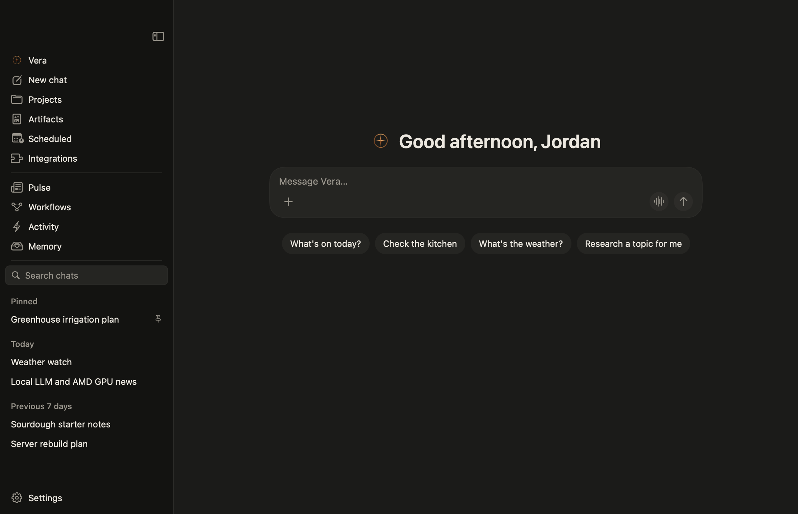
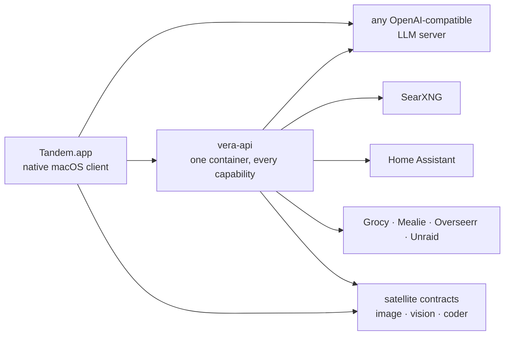
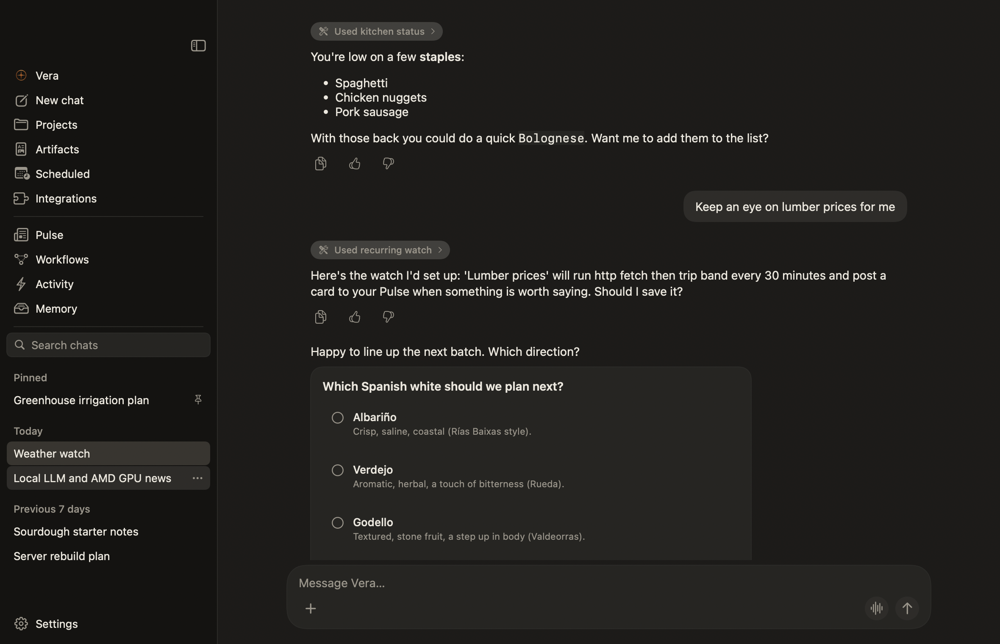

<div align="center">

# Tandem

**A self-hosted AI assistant for your home.**

[](https://github.com/DisplacedForest/tandem/actions/workflows/ci.yml)
[](https://github.com/DisplacedForest/tandem/releases/latest)
[](LICENSE)
[](apps/vera-mac)
[](services/vera-api)
[](services/vera-api)
[](apps/vera-mac)

[Setup](docs/SETUP.md) · [Contributing](CONTRIBUTING.md)



</div>

---

Tandem is a self-hosted personal AI assistant app: scheduled research briefings, opt-in ambient monitoring, persistent memory, and Home Assistant integration, running entirely on your own hardware with no cloud dependency. Tandem is the application; the assistant inside it is yours to name during setup. There is no built-in name: until you choose one, the app calls it "your companion", and so do these docs.

All endpoints, model servers, thresholds, and behavioral defaults are configuration: nothing is hardcoded: and every capability degrades gracefully when its dependencies are unconfigured.

## Architecture

Three components, connected by URLs:

- **An OpenAI-compatible model endpoint**: native text chat connects directly to its `/v1` API and keeps conversation history on the Mac.
- **vera-api** (optional): a single FastAPI service that lights up the ambient and experimental surfaces; each capability is one router: research briefings, ambient watch veins, home intelligence, kitchen inventory, document knowledge collections with retrieval, memory grooming, a scheduler, durable task storage with replayable events, and a typed confirm-before-acting actuation layer. The app is complete without it; connecting its URL adds these surfaces.
- **Tandem.app**: a native SwiftUI macOS client: chat, the Pulse feed, veins, memory curation, and integrations.



Run everything on one machine or spread it across several: topology is configuration. There are no hardcoded hosts in the tree, and the startup config report shows exactly what is wired.

## Features

### Chat: native, streaming, and local

Text chat streams directly from the selected saved OpenAI-compatible endpoint. Settings lists every model identifier returned by discovery, shows which model is selected and why, keeps the last successful model list for offline reference, and preserves the selection across relaunches. Conversations, messages, and inspected tool activity live in `~/.vera/vera.sqlite`, so chat works without vera-api. Each request's system context is assembled at send time in a fixed order: a compact shipped policy block, the active persona, user context, per-conversation instructions, the current date, time, and owner name, any recalled memory facts, and usage contracts for exactly the tools and presentation formats available to the selected model. Disabling a tool or switching to a model without tool support removes its instructions from the next request.

A native prompt library manages personas, user context, and reusable prompts in the local database with revision history, exact restore, markdown import and export, and a request preview that shows the read-only policy block above the user-authored sections. The previous single system prompt appears as the default persona after upgrade with no user action, and reusable prompts insert into the composer as message text rather than system text.

Native chat uses the standard OpenAI Chat Completions `tools` and streamed `tool_calls` fields. It validates names and JSON arguments before local execution, returns ordinary `tool` messages to the model, and continues until the model sends its final answer. The loop allows four tool rounds, eight calls, and at most two web searches per answer. At a limit, it makes one bounded tool-free synthesis attempt; if that fails, it preserves useful source excerpts and marks the answer unfinished. Each executor has a 20-second deadline unless a tool declares its own. Limits, denials, timeouts, and failures retain received text and activity. Apple Reminders is the first built-in. It is disabled by default, requests macOS permission when deliberately enabled in Settings, Tools, and supports explicit chat requests to list, create, and complete reminders. Web search reads a SearXNG instance's JSON API directly from the app, using the URL set in Settings, Search. Results arrive as numbered sources on the turn. Without a search URL the web search tool is not offered to the model, and the model is told plainly that search is not set up. A `fetch_page` tool reads one public http or https page and returns bounded readable text labelled as untrusted page content (8,000 characters by default, 20,000 at most). It refuses private, loopback, link-local and `.local` hosts and follows at most five redirects. Deep research is not a foreground tool. It runs as background work in the app's own task engine, using the same SearXNG and page fetching, and returns a cited report in the original conversation. Saving a search URL turns on Web search, Read web pages and Background work in Settings, Tools, and each stays off until then. Image generation renders through a ComfyUI server set in Settings, Image: the app ships the Qwen Image 2.1 graph, queues it over the ComfyUI API, shows live step progress with a Cancel control on the turn, and keeps the finished image with the conversation with Open, Save and Show in Finder actions. Without a ComfyUI URL the model is told image generation is not set up and points to that tab. The separate Settings, Plugins switch controls optional legacy service wiring and does not expose a native chat tool. Each call appears as a live expandable chip and remains with the conversation after relaunch. File tools appear only in chats that have a shared folder. Endpoints without standard tool calling continue as text chat and receive no private text protocol. Reviewed remote read tools use the [shared MCP catalog](docs/MCP.md); chat history starts fresh on a native install by design.

Background research needs a direct request in the current message, such as “Please start background research about lunar ice.” Earlier unfinished requests remain quoted context for follow-up questions. “Do not use any tools” disables tools for that turn. Repeated handoff calls from the same message reuse its saved task, even if the model changes its wording. Send a new message to request separate research. A background document request works the same way (“Write me a document about lunar ice” as background work) and lands as a markdown artifact in the same conversation and in Library. Progress and reports stay on the task card. Native research allows 30 seconds for planning and 60 for synthesis by default, with separate transport deadlines. These are bounded, nonpreemptive requests; a foreground message can wait for an already-running generation.

Additional tools are config, not code: drop a JSON declaration in `~/.vera/tools.d/` and the app loads it as a native chat tool alongside the built-ins, complete with its own Settings toggle, model-facing description, and confirmation policy. The app bundles a few declarations this way: an actions surface and skill authoring over vera-api routes, all of which light up once the vera-api base URL is configured. Anyone can add their own by pointing a declaration at any HTTP endpoint, such as a home inventory service reachable at `http://inventory.example:8090/items`.

Image attachments are native and local. Pick, drop, or paste png, jpeg, heic, webp, or gif images into the composer; each one is validated against a 20 MB cap, stored under the app's Application Support directory, and kept with its conversation across relaunches. Attached images go to the configured model endpoint as standard OpenAI-compatible `image_url` content parts, encoded inline, and to nowhere else. Local, remote, and Pulse media render natively, and anything that fails to load shows a placeholder instead of a broken layout.

Attachment routing is deterministic and disclosed. Every model carries a capability profile (image input, tool calls, streaming, an images-per-request limit) resolved from a small bundled name-pattern table of known vision families, and every field can be overridden per model in Settings, Model. Before each send the profile decides the route: a vision-capable model receives the image directly; a text-only model with a configured vision bridge (any separate OpenAI-compatible vision endpoint) gets the bridge's description of the image as clearly labeled context, never the image itself, with the route and full description visible on the turn; a text-only model with no bridge produces an explicit choice to send without the attachment or cancel. Nothing is sent silently, and a bridge failure keeps the message and attachment saved locally without contacting the model.

Advanced model controls live in Settings, Model behind a collapsed Advanced section, so ordinary setup never sees them. Every parameter is a typed declaration with a range, a scope, and a plain-language explanation: sampling (temperature, top p, top k, seed, penalties), tokens and stops, reasoning mode and effort, a streaming toggle, and a client-side context-length ceiling. Controls the selected model's capability profile cannot honor are disabled with the reason stated, overrides are stored per endpoint profile and model, and anything left at its endpoint default is omitted from the request entirely, so an untouched install sends exactly the same payload as before. A typed key-value editor covers provider-specific knobs through the chat template kwargs object, a per-request trace shows the final resolved parameter set actually sent, and when an endpoint rejects a parameter the app names it and offers a one-tap reset that retries without losing the message.

Native personal memory is an optional Mac feature. Approved memory is stored only on this Mac. Generating proposals and embeddings sends the current turn and your existing memories to the configured model endpoint, and Settings shows whether that endpoint is on this Mac or remote. Memory starts off, stores approved readable facts beside local chat history, retrieves only relevant approved and unexpired facts within fixed budgets, and places every generated create, update, merge, suppression, expiry, or deletion in a review queue. Approved episodic facts are removed automatically once their expiry date has passed, each removal recorded in the audit trail. The Memory Library organizes items as **You**, **Topics**, **Areas**, and **People**. Approved-memory storage and lexical recall have no server dependencies. With embeddings unset, recall uses local FTS5 search. Memory citations open the existing detail view with saved source evidence and corrections; optional extraction and semantic recall use configured model endpoints. Search past chats, Generate proposals, and Sensitive information are separate settings. Turning one off stops work already in progress, and sensitive text is never remembered unless you choose to have it suggested for review. The persistent-workspace runtime adapter consumes the same approved-memory authority as focused chats. Use **Record from evidence** in Memory to review typed facts, stock changes, and care records from saved messages; counts are calculated from approved evidence. Tandem also suggests these stock and care records from your conversations, quoting your exact words, and you review them like any other memory change. See [Native memory](docs/NATIVE_MEMORY.md).

<div align="center"></div>

### Knowledge: document collections that ground chat

Settings, Knowledge manages document collections stored in vera-api's document engine: create and describe collections, add txt, md, pdf, docx, or html files, watch each file's index state (pending, indexing, ready, failed with the reason, stale), search and sort within a collection, and reindex or remove files. Any chat can then ground itself on selected collections: each turn retrieves the most relevant passages, the reply cites them inline, and the sources row names the collection and file behind every citation. Retrieval status is always visible (searching, how many passages, none relevant, or unavailable). Knowledge is an API-backed surface like Pulse: without a vera-api URL Settings, Knowledge shows a clean unconfigured state and chat shows no knowledge controls, and nothing retrieved ever writes into personal memory automatically.

### Foreground model priority

When the native app has an engine configured, chat and vision requests reserve foreground capacity before calling the model directly. Background worker generations and automatic memory extraction yield to waiting foreground requests. One background generation per shared endpoint is the default, with a bounded generation deadline. The app keeps its provider key locally; admission sends only an endpoint fingerprint and timing metadata. No engine configured leaves standalone native chat unchanged. See [inference admission](docs/SETUP.md#inference-admission) for failure behavior and configuration.

### Your companion and ordinary chats

The narrow global rail contains **Home**, **Library**, **Scheduled** and **Plugins**, with hover labels. **More** keeps Projects management, Pulse, Workflows, Activity and Memory available. Settings and the sidebar toggle sit at the bottom. Beside it, the chat sidebar contains **New chat**, search, your named companion, expandable projects with their chats, and recent conversations. Hover or focus a project row to start a chat there or open its options. Collapsing the chat sidebar keeps the global rail available. The companion conversation is one pinned, ongoing conversation on the native chat engine. It keeps its own history and draft, separate from focused chats, and cannot be deleted from the list. **New chat** opens a separate ordinary conversation, and drafts are kept per conversation. Integrations is live, see [Connected services](#connected-services). Projects is live, see [Projects](#projects). Library is live, see [Library](#library). Scheduled is live, see [Scheduled work](#scheduled-work). Ordinary chats answer one message at a time in each conversation and save later messages in a visible queue. Returning to your companion preserves its thread, draft and tasks. Ordinary chat queues allow at most two active foreground turns across their conversations and eight waiting messages. A full queue keeps your draft and attachments intact.

Each answer has its own Stop control and tool approvals. Stopping an answer does not cancel a separate research task; use the task card's Stop research control for that. Accepted messages are saved before the composer clears. After a restart, unsent messages can resume with their original settings, while interrupted requests stay available for explicit review or retry. An uncertain action is never automatically replayed. Ephemeral keyed configurations without a stable saved profile require a new message after restart.

The conversation header shows its title. Replies sit in bubbles and your own messages are right-aligned. When a reply produces a document, a research report, an image or a canvas piece, a result row under it has an Open button. Reports and documents open in their reader and canvas pieces open the canvas. An action that needs your permission shows up inline as a card with Decline and Allow, and an arrow beside each for a choice that sticks. A declined action is shown as declined, not as a failure.

The **Ongoing work** panel on the right lists the background work in the current chat with a title and a plain state for each. Selecting one scrolls to its card, and selecting a finished one opens its result. **View all work** shows every chat's work. On narrower windows, work stays accessible through its cards in the conversation, including progress, approval, retry and stop controls. The canvas and the panel share the right column, and an open canvas piece takes precedence.

Ordinary chat composers say **Message Tandem**. The companion conversation uses its saved name. The composer is one rounded field: a plus menu (files, folders and saved prompts), the message field, and the send button.

### Library

Library collects what Tandem produces across all your conversations: documents (background documents and cited research reports), images from image generation, every file created, edited, moved or trashed inside a shared folder, and the markdown, code, HTML, SVG and diagram pieces a reply can put on the canvas. Each row shows the title, what it is, the conversation it came from and a plain date. Search by name and filter by kind. Until something has been produced, the view explains what will collect there.

Opening an artifact shows it the way it should be read: rendered markdown with citations for research, an image viewer, a side-by-side diff for file changes, and a preview for canvas pieces. Buttons appear only when they apply: Open in conversation, Revise, Save as, Reveal in Finder (for images and for file changes whose file still exists) and Copy.

Revise asks what should change and sends that request into the conversation the artifact came from, with the artifact referenced. If the reply produces a new piece of the same kind, it becomes the next version. The artifact lists its versions, and any version can be viewed or saved. Editing a canvas piece's source in the side panel is not kept, so ask for the change in chat instead. Deleting a conversation that has artifacts asks whether to keep them or delete them too. Kept artifacts stay in Library under the name of the conversation they came from, without Open in conversation. See [Library in the setup guide](docs/SETUP.md#library) for storage.

### Projects

A project groups related chats, instructions, source folders and attached files. Expand its name in the sidebar to open a chat, or use its New chat button. Hover the project for a compact preview without leaving your conversation. Project options provides the same details from the keyboard. Edit project stages its name, instructions and folder changes until Save; Cancel discards them. Manage project files opens a separate manager with immediate add/remove actions. Projects under More provides the same editing controls. Deleting a project keeps its chats and saved work, which stop being grouped.

Project chats keep the project name beneath the composer, with Files and Plugins beside it. The project name opens its editor. Files offers chat attachments, a shared folder and the project file manager. A new project chat starts with a focused prompt; switching chats keeps each draft separate. Ordinary New chat starts outside the project.

A chat opened inside a project receives its current project name on each request and follows the project's instructions, applied after your persona and before the chat's own instructions. It can read and edit files in the project's folders without you sharing them again, alongside any folders shared with the chat itself. Attached files can be read through the file tools as a read-only folder, and the tools refuse to change them and say so. A conversation belongs to at most one project. From the chat list, **Move to project** and **Remove from project** change membership, and the next turn gains or loses the project context.

Memory can be scoped too. Facts suggested from a conversation inside a project are tagged with that project, and recall inside the project puts those facts ahead of shared ones within the usual limits. Outside the project, recall works as it always has. The Memory Library can filter by project and shows which project a fact came from. See [Project scope](docs/NATIVE_MEMORY.md#project-scope) for the details. Projects don't index the contents of attached files, and they can't be shared, templated or nested.

### Connected services

**Integrations** in the rail has two views. **Personal** lists every remote MCP server you have set up, with its state in plain words and the action that fits: Connect, Sign in or Disconnect. Under each server you see the read tools it offers and can turn each one on or off, run **Try** to test a read tool without a model, and choose where the server applies: focused chats, your companion's thread or background work.

**Public** is a bundled starter list of well-known remote HTTP MCP servers, each with its name, publisher, description, category, endpoint and whether it needs no sign-in, an access token or an account sign-in. Search it or browse by category. **Install** opens a review of the endpoint, the proposed read tools (any of which you can leave off) and the scopes. Confirming creates your personal entry and continues with the usual connect or sign-in step. An entry you already installed shows Installed. Listing a publisher is not a verification of the service, so review each one before you connect it.

**Manage** opens a sheet with the entry's name, endpoint, read tools, scopes, authentication and timeout, plus **Remove**. Removing a server disconnects it, and its tools stop being available everywhere at once. Local stdio servers are not supported. See [Connected service tools](docs/MCP.md) for authentication, limits and the configuration file.

### The dot

The persistent companion conversation is one named assistant working on a standing goal. Its profile holds the name, a standing goal, the connected services it can reach and rules that can only be stricter than the defaults in Settings, Rules. The first time you open the companion conversation, it introduces itself and asks one question at a time. Answer naturally to set its name, goal and permissions, or skip a question and start talking. Profile changes appear in the same settings you can edit yourself. Relaxing a companion restriction or connecting another enabled service asks for approval of the exact change, and global restrictions still apply. Preference notes become memory suggestions for review when memory is on. Returning to the companion restores the message you were reading, including after relaunch. New replies stay below while you read earlier messages. The conversation has no header strip. The companion's figure and name sit in a small pill at the top of the conversation. Click it, or the sidebar button at the top right, to open its profile. It slides in beside the conversation, which narrows to make room, and slides back out with the same button or Escape. The profile starts closed every time you open the app. It shows the figure, the name and when the companion was last active, then Recent activity, Outputs and the companion's upcoming schedules, each with a switch to turn it on or off. A small green dot marks activity that's new since you last closed the profile. Pause, Appearance and profile settings are in the profile's menu. Select a recent activity to read its request and available progress or result in the profile. Back returns to the overview. Go to chat opens the original conversation and its task card. Retry and Stop appear when the task supports them. Outputs open the results the assistant produced, and Show more opens its Library. Pause holds the schedules that deliver to your companion's thread. Their runs are recorded as skipped and nothing catches up after you resume, while chat keeps working. The goal and rules are added only to requests in your companion's thread, never to focused chats or background workers. A service turned off for your companion's thread stays off there even when it is on in Settings. Start over, in the same settings, removes the conversation, the memories and pending suggestions that came from it, its schedules and the goal, then opens a fresh conversation with a new introduction. Memories from other chats and everything in Artifacts stay.

The companion can also work on its own. Type an assignment under **Give Ada work** in the panel beside the companion conversation (it uses the companion's saved name) and it becomes a message in the companion conversation with a task card under it. The work runs in a fresh, private context: the companion's name, its rules, its saved goal and the assignment, never the conversation history. It can use the connected services and tools turned on for the companion, in short rounds, and the card shows progress. Anything that changes something follows your rules. An action set to ask shows Approve and Decline on the card, and approval covers that exact action only: if your rules or folder access change, or ten minutes pass, it has to be asked again. An action set to leave it to you stops the work there, and the card says the step was not run and shows the step for you to do. It keeps going until the work is done, something fails, or you press Stop. If Tandem quits or a request times out partway through an action, it never repeats the action on its own. It checks where it can, and otherwise asks you whether it happened. The finished report lists each action with what was observed and lands in Library. Work that stops at a step isn't saved to Library. Start over cancels work in progress before the conversation is cleared.

### Durable background task storage

In your companion's persistent conversation, task cards stay with the message that started them. Updates arrive from the task event stream, and reopening the app refreshes saved work before resuming that stream. Stop and decision replies go to the task engine. Completed file outputs open only from the configured task workspace.

The app's own task engine holds the queue. It stores queued work, checkpoints, decisions, results, and ordered events in the app's local database next to the conversations. Background research plans sub-questions, searches the configured SearXNG, reads pages, and saves a report with numbered citations. Background documents are written the same way, one bounded model call per step. Tasks resume from committed checkpoints after a relaunch, and cancellation preserves collected evidence. Missing sources or an unusable report ask for an explicit retry. With Background work enabled in Settings, Tools, typed native chat can hand research or a document to this queue and continue the conversation. Research is refused with a plain explanation when no search URL is set. The app saves the request before starting it and can replay an interrupted handoff without creating another task. Generation uses the saved model profile and local credential. Progress stays in the original chat as a saved task card, with Stop and an explicit Retry when needed. Completion adds one cited report or document that opens inside the app. Cards recover after relaunch, and saved reports remain readable. The optional vera-api still has its own task API for its own clients; see [the task API setup notes](docs/SETUP.md#durable-task-api) for its contract and limits.

### Background document drafting

In the native assistant, ask your companion to write a document in the conversation and it hands the work to the app's task engine with a brief, a short title and any inputs. The worker outlines, drafts and revises each section with one bounded model call per step. A brief that asks for exactly N bullets produces one validated list body. Progress is saved between steps, and the finished markdown document is delivered as an artifact in the same conversation and collected in Library. The task card reads Writing, then Document ready, with Stop writing while it runs. An interrupted model call waits for an explicit retry, and completed sections remain saved. It uses the saved provider with its authorized spending allowance, and only the current request, without connected tools, memory retrieval or earlier conversation content. The vera-api task API still accepts `document` work for its own clients. See [document tasks](docs/SETUP.md#document-tasks).

### Scheduled work

The Scheduled view lets you set up research or document runs that happen on their own. Give a schedule a name, say what it should do (research into a question, or a document written from a brief), pick where the results go (your companion's thread, or a chat of its own named after the schedule), and choose a repeat: every day, weekdays, weekly, every few hours, or once. Cadence is always shown in plain words, like "Every day at 7:00 AM" or "Every Monday at 9:00 AM". There's no cron syntax anywhere. The time zone you created the schedule in is saved with it, so the clock time stays put if your Mac travels.

You can also make a schedule from any chat. Ask for recurring research or a document in plain words, like "every weekday at 7, research overnight chip export news", and a confirmation card shows the cadence and the work. Nothing is saved until you approve it. Approving creates the schedule and it shows up in Scheduled, where each row says where its results go. This needs Background work turned on in Settings, Tools, and a research schedule still needs the search URL.

Each run adds a turn to the owning chat, with the instruction as your message and a reply that carries the same task card and report or document that background work produces, including Stop and Retry. Every schedule keeps a run history with the outcome in plain words (Finished, Couldn't finish, Stopped, Missed, Skipped or Couldn't start) and an Open button that jumps to the chat holding the run. A run can also be Waiting for you, when the background task stopped to ask a question, or Blocked, when it can't continue until Tandem is open with the saved model profile. Neither counts as finished, and neither stops the next scheduled run from going ahead. You can run now, pause, edit or delete a schedule. Deleting one removes its history but keeps the chats.

A waiting run shows its question and the choices, such as Retry, as buttons in Scheduled. Picking one answers the task and the run goes back to Running. The schedule's status line and the menu bar item say how many runs are waiting for you. The first time a run waits, the chat holding it gets one message quoting the question with the same task card, so you can answer there too. It isn't repeated after a relaunch. Before asking anything, a failed model request (a timeout, a usage limit or an incomplete reply) is retried once automatically in the same step, and the run notes "The model request did not complete. Trying once more." A second failure in that step asks you.

The scheduler lives in the app, so it only fires while Tandem is running. If a time passes while the app is closed or the Mac is asleep for more than five minutes, that run is recorded as Missed and isn't made up later. If the previous run is still going when the next time arrives, the new one is recorded as Skipped. Once you have a schedule, Tandem stays in the menu bar when you close the window, showing the next run and how many are in progress. You can turn that off in Settings, Identity. Research schedules need the search URL set in Settings, Search. See [Scheduled work in the setup guide](docs/SETUP.md#scheduled-work) for details.

### Tandem identity

Tandem is the application name. The assistant inside keeps whatever name you chose. There is no built-in name: until you choose one, the app calls it "your companion". The app icon is two overlapping green circles on a charcoal tile, and the menu bar item uses a monochrome two-circle mark that adapts to light and dark menu bars. The logo moves in response to real events, such as a greeting on launch and a bounded orbit while an answer is being generated, and it stays still when Reduce Motion is on. Details are in the [setup guide](docs/SETUP.md#tandem-identity).
### Quick ask

Press Option Shift Space from any app to open a small quick-ask panel that floats over whatever is in front. It shows the last few turns of the assistant's ongoing thread (the pinned conversation at the top of the sidebar), a composer, and a count of replies you haven't seen yet. Sending from the panel is the same as sending in that thread, with the same model, tools, rules and memory, and the reply streams into the panel. Open in Tandem jumps to the thread in the main window, and Escape or clicking elsewhere hides the panel. Your draft is kept when it hides. When something is waiting for your approval, including the companion's own work, the panel says so and Open in Tandem takes you to the card. You can change the shortcut in Settings, Identity, under Quick ask. See [Quick ask in the setup guide](docs/SETUP.md#quick-ask) for details.

### Companion appearance

The assistant also has a small companion figure, and you can change how it looks from Settings, Identity, Change appearance. Pick one of three shapes (Pebble, Fold or Mallow) and one of seven colors (Sage, Periwinkle, Apricot, Rose, Sky, Mint or Pearl) in any combination, and the sheet shows a live preview under the same assistant name you use everywhere else. Nothing changes until you press Save, and Cancel keeps the previous appearance. The figure shows up wherever the companion does, including the sidebar, and it reflects what the assistant is doing in the conversation you have open. Its states are shown through motion: ready, thinking, resting and needs you. Needs you only appears while a real question is waiting (it hops once, then holds), and with Reduce Motion on every state is a still pose. Details are in the [setup guide](docs/SETUP.md#companion-appearance).

### Working in folders

Any chat can work in folders you hand it. There's no mode to switch on. Choose "Work in a folder" from the composer's plus menu or the @ picker, or drop a folder onto the composer (dropping a file still attaches it). Each folder shows as a chip above the composer with its name, and the x on a chip takes the access back. Shared folders belong to that conversation (a chat inside a project also gets the project's folders) and are still there after a relaunch. A folder inside one you've already shared is refused, and sharing a parent replaces any shared folders inside it.

While a chat has a folder and the model supports tool calling, Tandem can list folders, read text files, search for text across a folder, write files, edit them by exact replacement, move or rename them, create folders, move files to the Trash and run commands with the folder as the working directory. Nothing is ever deleted outright, and moving never overwrites. Every path is checked against the folders you shared, including symlinks that point elsewhere, and anything outside is refused with the path named. Each changed file shows on the turn as a card with a before and after diff and Open and Reveal buttons, and each command shows as a card with the exact command, the output, the exit status and why it was allowed to run. The cards stay with the conversation. If the current model can't call tools, the chat gets no file tools and the folder control says so. See [Working in folders in the setup guide](docs/SETUP.md#working-in-folders) for the limits.

### Rules

Settings, Rules decides what your companion may do on its own. Each kind of action (editing files in shared folders, running commands there, moving files to the Trash, sending on your behalf, running risky commands, changing your reminders, making changes through connected services, making other changes) has one of three settings: do it without asking, ask first, or leave it to you. Risky commands are privileged commands and commands Tandem can't read with confidence. Commands that send data elsewhere follow the sending rule. The defaults are edits act, commands ask, Trash asks, sending asks, risky commands are left to you, other changes ask. Three things are always handed to you: entering credentials, paying or transferring money, and permanently deleting outside a shared folder. Each of the three can be turned on one at a time under Advanced at the bottom of that tab. When a setting asks first, typing an instruction that starts with the action and names exactly what it applies to, like an address, a file name or a command in code marks, does that one thing once without asking; it never overrides a setting of leave it to you, anything under Advanced that isn't turned on, or a rule you saved to never do something. Before it runs, the model is asked to confirm that's what you meant. When it isn't sure or doesn't answer in time, you get the usual card. Nothing said in a conversation can loosen your rules without your click. A chat can tighten these from the Rules button next to its folder chips, never loosen them. When a rule asks, a card on the turn shows exactly what would run, with Decline and Allow. Allow lets it happen once, and the arrows beside the two buttons hold the choices that stick: always allow in this chat, always allow everywhere, or never. Allowing a command covers later commands that start with the same two words, and Never on a command card stops commands in that chat. Choices you save are rules you can take back from the chat's Rules button. Declining tells the model it was declined and nothing runs again without a new request. See [Rules and commands in the setup guide](docs/SETUP.md#rules-and-commands).

### Pulse: scheduled research briefings

Tandem researches overnight: topics drawn from its own accumulating interests and what the household actually asks about: and produces briefing cards with cited sources, inline statistics, and charts. Pulse remains an optional vera-api surface. Continue in chat turns a card into a durable native conversation: the card's text, citations, and provenance are copied into the local database as the first message, so the conversation opens and survives even after the card expires or vera-api goes away. Creating that first continuation is the only step that needs vera-api reachable; each card maps to one local conversation, and continuing again reopens it. Remote card images are not cached locally and fall back to the existing placeholders when their source disappears.

<div align="center"></div>

### Veins: opt-in ambient monitoring

A row of status chips above the feed, one per vein: each an independently configured monitor that stays quiet until a configured threshold is crossed. **Tandem ships with none**: a vein is something you build for your own life. A river gauge, a service-status watch, a geopolitics bar: describe what deserves an ambient eye and the in-app builder turns the conversation into a schema-validated JSON definition with a block pipeline (search, fetch, threshold math, LLM judge/compose) and a schedule; dropping a definition file in place works too. Thresholds determine what surfaces; the model only explains what crossed them, one card per distinct situation, updated rather than stacked. Veins are portable files: export one and you get a `.vein.json` scrubbed of deployment specifics, import one and it lands disabled for review, so a monitor you build is a file anyone can drop into their own Tandem.

<div align="center"></div>

### Workflows and Activity: the autonomy control room

Pulse, Workflows opens on a living canvas: every flow Tandem runs on its own: briefings, vein runs, grooming: drawn as a node graph connected to the surfaces it feeds, served by the API as a manifest (`GET /agentic/graph`) so new capabilities appear on the canvas without an app update. Running flows glow, outcomes tint their nodes, recent events travel their edges, and a node that used a tool carries a badge naming it on hover. All of it rides the built-in scheduler: a job tied to a vein or integration does not fire until that vein or integration is enabled, and gated jobs report why they are not running.

The map and the editor are two zoom levels of one surface: clicking any flow opens it in the same workflow editor. Every flow is served as a workflow definition through the same endpoints (`GET /agentic/workflows/{id}` and its catalog), with a Schedule trigger at the head reflecting the flow's real schedule: scheduled code-backed flows project their steps, veins project their block pipelines, and Pulse serves its stored graph. Opening a flow turns the existing app sidebar into a searchable node library and dedicates the main workspace to the connected workflow and selected-node inspector. The library, each node's configuration fields, and the graph rules all come from the server's catalog, so a node type registered server-side appears in the palette with editable, schema-rendered settings without an app update.

Each flow carries a served profile that decides what editing it allows. Pulse's profile permits structural editing: nodes can be added, wired, configured, and arranged in a draft; the server's validation verdict decides when a draft can be saved or promoted, and the published flow stays unchanged until that draft is explicitly promoted. Code-backed flows carry a locked profile: their graphs render, pan, and inspect like any other, structural affordances are simply absent, and the server rejects structural edits; settings each node's schema declares (starting with the schedule on its trigger) stay editable through the same draft and promote path. Every workflow starts with a trigger node configured in plain schedule fields that map to the built-in scheduler, so what starts a flow is visible and editable right on the canvas. A schedule set outside those fields (a server env override, a custom cron) renders as server-managed instead of masquerading as an editable default.

The same canvas also replays results: a Run toggle overlays the latest recorded run on the graph, tinting each node by how it finished and captioning it with its output count and duration. Selecting a node in run mode swaps the inspector to what that node actually recorded (input, output, timing, state, and any error) and the visual review nodes show their per-card evidence, cover image, verdict, and retry. Run mode is read-only over recorded runs; with no run recorded yet it says so instead of inventing one.

Everything Tandem does on its own is also auditable in one place: an Activity feed (`GET /agentic/activity`) merges scheduled job runs and autonomous actions into a single newest-first list, shown under Pulse, Activity. Autonomy is wanted, and it is always visible.

<div align="center"></div>

### Plugins: configured from the app

This is the Settings, Plugins store for the optional server-side integrations, separate from Connected services in the rail. Each integration is a card: enter a URL and key, test, enable. Enabling an integration activates the capability across the stack. Experimental features (whole-house behavior modeling, media curation) require explicit consent and state exactly what they do before they can be enabled.

<div align="center"></div>

### Memory and home control

Tandem maintains an inspectable, editable memory store and grooms it nightly: every change reversible and surfaced as an audit card. With Home Assistant connected, Tandem answers from live home state and acts through a typed, confirmation-gated action system; nothing in the home actuates without an explicit confirmation. Trust is graduated per verb: an action explicitly enrolled as autonomous: which the registry permits only for low-risk, trivially reversible verbs: executes without a confirmation and surfaces afterward as a System card. Exactly one verb is enrolled: recipe import, so Tandem can save a recipe it finds worth keeping into the household cookbook on its own, capped, deduplicated, and announced after the fact.

## The endpoint matrix

Every external dependency is a configuration slot with defined behavior when empty:

| Slot | Contract | Powers | When absent |
|---|---|---|---|
| Main LLM | OpenAI `/v1` | Native text chat and configured generation | Chat reports unconfigured; API surfaces still serve |
| SearXNG | `/search` JSON | Chat web search and background research in the Mac app, research, watcher veins, image sourcing | Search-dependent features report unconfigured |
| Coder LLM | OpenAI `/v1` + tool calls | Cross-model claim auditing, fact verification | Audits fall back to the main model; daily features unaffected |
| Image gen | OpenAI Images API | Pulse cover art | Cards use the best researched image instead |
| Vision | OpenAI chat + `image_url` | Image understanding in chat | Vision tools report unconfigured |
| Playwright | run-server websocket | Full-page renders for research | Falls back to snippets |
| Embeddings | OpenAI `/v1/embeddings` | Document knowledge indexing and retrieval, Pulse novelty ranking | Collections stay manageable; indexing and retrieval report unconfigured |

| Integration | Powers | When absent |
|---|---|---|
| Home Assistant | Live home state, actuation, the `ha_state` vein block | Home features off |
| Grocy / Mealie | Kitchen inventory, expiry, recipes (pairing unlocks suggestions) | Kitchen tools off |
| Overseerr | Media requests, weekly curation digest (consent-gated) | Media curation unavailable |
| Unraid | Container updates, host actuation | Those update sources drop from update digests |
| Apple Reminders | Reminders lists read/write from chat, shared lists included (through the headless EventKit bridge, on a Mac signed into iCloud) | Reminders tools off |

<details>
<summary><b>Example deployment</b></summary>

<br>

One Linux server runs vera-api, SearXNG, and an RTX 3090 serving the main model via llama-swap. A Mac Studio runs the MLX satellite services (image generation, vision, the coder model) on demand, and a Mac mini runs the Apple Reminders bridge. A single capable machine can run the entire stack, and any component can be replaced by a hosted equivalent by changing one URL.

</details>

## Quick start

**Backend** (any Docker host: pulls the released image from GHCR):

```sh
git clone https://github.com/DisplacedForest/tandem.git && cd tandem
cp .env.example .env     # fill in the backend services you use; everything is optional
docker compose up -d
docker compose logs vera-api | head -60    # the config report: what's wired, what's not
```

Local source builds can reuse a Keychain-owned signing certificate; see [local signing setup](docs/SETUP.md#stable-signing-for-local-builds).

**App** (macOS 26+; earlier macOS can run releases up to 0.2.x): download `Tandem.app.zip` from the [latest release](https://github.com/DisplacedForest/tandem/releases/latest), unzip, drag to Applications. The app is ad-hoc signed, so the first launch needs right-click → Open.

**Backend without Docker** (macOS arm64): each release also ships `vera-api-macos-arm64.zip`, a self-contained engine binary: verify the checksum, unzip, run; data lands in `~/.vera/data` (see `docs/SETUP.md`).

**Backend on the Mac, app-managed** (macOS arm64): in the app, Settings, Services, Engine, **On this Mac** downloads and runs that same engine as a checksum-verified background service on `127.0.0.1`, points the app at it, and keeps it in step with app updates. No Docker and no terminal (see `docs/SETUP.md`).

Building either from source instead:

```sh
docker compose up -d --build        # backend (uncomment `build:` in docker-compose.yml)
cd apps/vera-mac && scripts/deploy.sh   # app: packages Tandem.app and installs it to /Applications
```

Onboarding has four steps: Endpoint (a friendly name, an OpenAI-compatible URL ending in `/v1`, and an optional key saved in the Mac keychain), Model (explicit discovery and selection), Memory (optional local memory, can be skipped) and Pulse (an optional vera-api service URL, can be skipped). Persona and tools live in Settings. The guide is skippable and can be resumed from Settings, Endpoints without touching chat history. vera-api remains optional and independently powers Pulse and the other ambient surfaces.

<div align="center"></div>

The full walkthrough, including native chat and every integration: **[docs/SETUP.md](docs/SETUP.md)**.

## Constraints

- The reference satellite services (image, vision, coder) are MLX-based and require Apple Silicon. Each implements a documented HTTP contract (OpenAI Images, OpenAI chat) that any compatible service can satisfy: the contracts are the interface; the references are one implementation.
- The native app requires macOS 26 or later. The packaged Pi runtime targets Apple silicon. The backend runs anywhere Docker runs.
- Tandem is built for a single household, not multi-tenancy.

## Contributing

Issues and PRs are welcome; merged work is credited in the next release's notes. See [CONTRIBUTING.md](CONTRIBUTING.md) for the conventions: everything parameterized, live data only, graceful degradation, one capability per router.

## License

[MIT](LICENSE).

The optional [household assistant messaging gateway](docs/HOUSEHOLD.md) reuses API modules in a dedicated loopback runtime, with separate inboxes and explicit sharing consent. It defaults to disabled and requires endpoint keys before household use. An optional HTTPS connection lets household members add one MCP address to ChatGPT and connect their own inbox with a one-time code, without a household account signup.

Remote read-only tool connections use the shared native MCP catalog. See [connected service tools](docs/MCP.md) for explicit setup and current boundaries.
